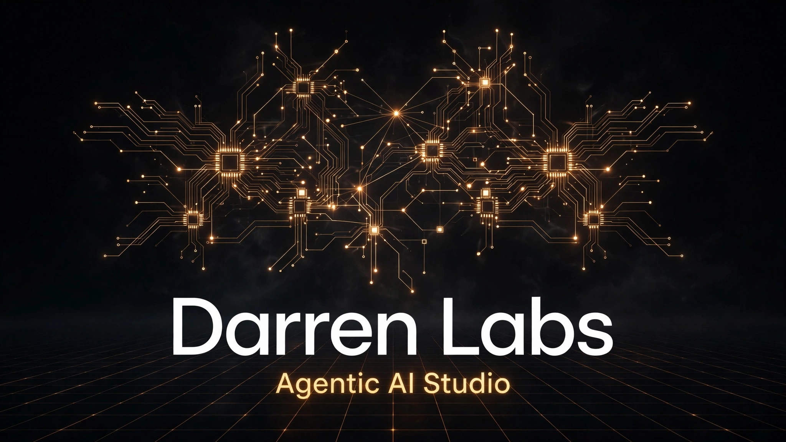

# Darren Labs

<p align="center">
  
</p>

**Darren Labs** is an agentic AI studio. We design and ship agentic AI systems that build real software.

Live site: **https://darrenlabs.pages.dev/**

## What this repo is

This repo is the Darren Labs company website: a single-page static site with an
interactive Three.js 3D story section. No build step and no framework.

## The studio

- **Founder:** Tri Adi S, professionally known as Darren Lieu. CEO of Darren Labs,
  working toward becoming an AI architect: setting direction while agents own
  execution, sequencing, and verification.
- **Method:** Brief -> Generate -> Verify -> Fix -> Re-verify. One person sets the
  direction. Agents build. A human verifies the result.

## Flagships

1. **VoltWorks Power** - power-system CAD that removes repetitive drafting.
   True-scale 3D (1 unit = 1 m), a single-line-diagram (SLD) builder with an
   integrated 3D view, and engineering calculators that show their work
   (IEC 60364 and 60909, IEEE 1584-2018, NFPA 70E).
2. **MEP Suits** - a building-services mechanical toolkit, built by an engineer
   for the plant room. Eight calculators (Duct Sizer, Psychrometrics, Ventilation,
   Pipe Hydraulics, Water and Coil Loads, Fan Laws, Room Cooling Load, Unit
   Converter) plus a 3D System Viewer linked live to the duct and pipe
   calculators. A design aid: results must be verified by a licensed engineer
   before construction or procurement.
3. **AI Architecture Patterns** - a visual design library for AI systems:
   diagrams, trade-offs, runnable demos, and guidance on when not to use
   each pattern.

## The 3D site

The hero story section is a single scroll-driven Three.js scene with three
labeled zones: **AI Studio**, **VoltWorks Power**, and **AI Architecture Patterns**.
Scroll builds the scene chapter by chapter; drag orbits; selecting an item shows
a short description. Rotation is off by default and the scene respects
reduced-motion settings, with a plain 2D fallback when WebGL or the libraries
are unavailable.

All 3D models are real open-source GLB files (CC0 from Poly Haven, plus the
robot and pylon from the three.js repo under their stated licenses), lazy-loaded
per chapter. Full provenance, licensing, and loading details are in [ASSETS.md](ASSETS.md).

The site uses a dark-studio theme. Three.js (r128) loads from public CDNs with
multiple fallback URLs; if it or WebGL is unavailable, the page falls back to a
static presentation.

## Contact form

The `#contact` section has a project query form backed by Web3Forms: name,
email, and project description, with a honeypot anti-spam field. It posts to
`https://api.web3forms.com/submit` and shows inline feedback on success or
failure. The Web3Forms access key in `index.html` is a public client-side key.

## Structure

```
index.html      Site markup (single page)
styles.css      Dark-studio styling
script.js       Three.js scene, chapter logic, contact form
models/         Open-source GLB models used by the 3D scene
ASSETS.md       Model provenance, licenses, loading details
LINKEDIN.md     Notes on LinkedIn presence
RENDER.md       Notes on the retired Render hosting
is-a-dev/       Retired is-a.dev subdomain paperwork (historical)
```

## Run locally

```sh
python3 -m http.server 8000
```

Then open http://localhost:8000 in a browser. No build, no dependencies.

## License

MIT. See [LICENSE](LICENSE).
