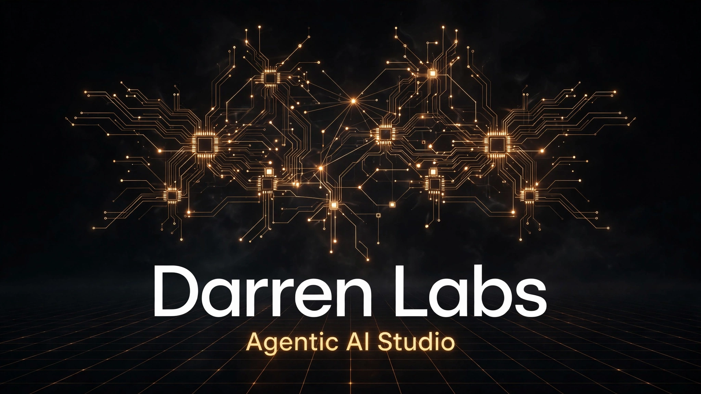

# Darren Labs

<p align="center">
  
</p>

**Darren Labs** is an agentic AI studio. We design and ship agentic AI systems that build real software.

Live site: **https://darrenlabs.pages.dev/**

## What this repo is

This repo is the Darren Labs company website: seven pages in a pure-ink
style, washi paper, sumi ink, one vermillion seal accent, with a traced
ink painting as the hero art and Shippori Mincho as the display face.
No build step and no framework.

## The studio

- **Founder:** Tri Adi S, professionally known as Darren Lieu. CEO of Darren Labs,
  working toward becoming an AI architect: setting direction while agents own
  execution, sequencing, and verification.
- **Method:** Brief -> Generate -> Verify -> Fix -> Re-verify. One person sets the
  direction. Agents build. A human verifies the result.

## Flagships

1. **VoltWorks Power** - power-system CAD that removes repetitive drafting.
   True-scale 3D (1 unit = 1 m), a single-line-diagram (SLD) builder with an
   integrated 3D view, and engineering calculators that show their work
   (IEC 60364 and 60909, IEEE 1584-2018, NFPA 70E).
2. **MEP Suits** - a building-services mechanical toolkit, built by an engineer
   for the plant room. Eight calculators (Duct Sizer, Psychrometrics, Ventilation,
   Pipe Hydraulics, Water and Coil Loads, Fan Laws, Room Cooling Load, Unit
   Converter) plus a 3D System Viewer linked live to the duct and pipe
   calculators. A design aid: results must be verified by a licensed engineer
   before construction or procurement.
3. **AI Architecture Patterns** - a visual design library for AI systems:
   diagrams, trade-offs, runnable demos, and guidance on when not to use
   each pattern.

## The ink hero

The hero art is `painting.svg`, a traced ink painting: a red sun over
misty mountains, a pagoda on a cliff, pine trees. The sun is alive: a
breathing halo, a red rim disc, and three mist wisps drifting across
it, all animated inside the SVG. The rest of the page stays still,
and reduced-motion stops all three. The display face is Shippori
Mincho, self-hosted Latin subsets in `fonts/`.

The earlier Three.js story hero is retired. The `models/` folder holds
the open-source GLB models from that era, unused by the current pages
and kept as inventory. Full provenance and licensing are in
[ASSETS.md](ASSETS.md).

## Contact form

The `#contact` section has a project query form backed by Web3Forms: name,
email, and project description, with a honeypot anti-spam field. It posts to
`https://api.web3forms.com/submit` and shows inline feedback on success or
failure. The Web3Forms access key in `index.html` is a public client-side key.

## Structure

```
index.html      Home: hero, flagships, method, about, contact
models.html     DarrenLabs AI Models, with measured timings
styx.html       Styx, the local desktop agent
projects.html   All projects, as an index
products.html   Products
lab.html        The Lab bench, with first-run results
note-001.html   Note 001: verification is the work
404.html        Custom not-found page
painting.svg    The ink painting hero art, with a living sun
fonts/          Shippori Mincho, self-hosted Latin subsets
styles.css      Ink styling, tokens at :root
script.js       Navigation, dropdown, contact form
models/         Open-source GLB models, unused by the current pages
ASSETS.md       Model provenance, licenses, loading details
LINKEDIN.md     Notes on LinkedIn presence
RENDER.md       Notes on the retired Render hosting
is-a-dev/       Retired is-a.dev subdomain paperwork (historical)
```

## Run locally

```sh
python3 -m http.server 8000
```

Then open http://localhost:8000 in a browser. No build, no dependencies.

## License

MIT. See [LICENSE](LICENSE).
